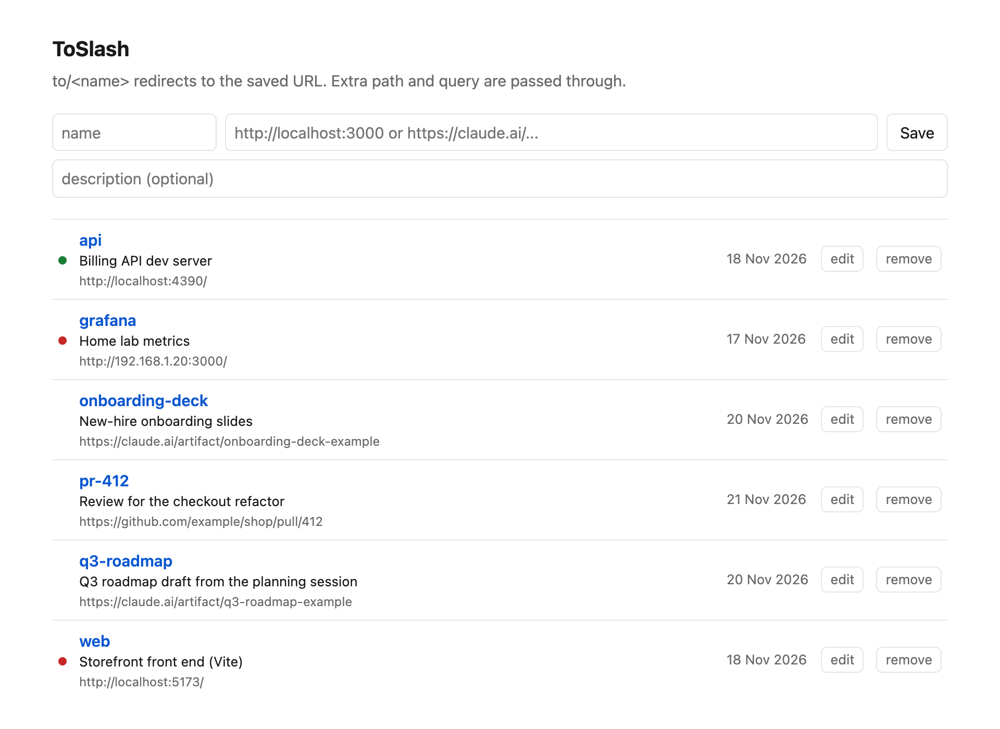

# ToSlash

Short links for everything you work with, from the menu bar. Type `to/<name>`
in your browser and land on the right place: a dev server on some port, a box
on your home network, or a page an AI agent made for you last week.

- `to/api` opens `http://localhost:4390`, so you stop guessing which port runs which app.
- `to/roadmap` opens a hosted page, such as a Claude artifact, that would otherwise be lost in chat history.
- `to/` lists every link with its description, the date it was added, and a live dot: green when a local or LAN target answers, red when it does not.

Extra path and query pass through: `to/api/users?id=7` opens
`http://localhost:4390/users?id=7`.



## Install

ToSlash needs macOS 14 or later, on Apple silicon or Intel. Each release's dmg
is built by GitHub Actions from this repo. Install it with Homebrew or by hand.

### Homebrew

```sh
brew tap nicholasren/toslash https://github.com/nicholasren/toslash
brew install --cask nicholasren/toslash/toslash
```

Homebrew checks the download against the SHA-256 in the cask, which the release
workflow updates after each release. The cask then removes the quarantine flag
from the app. That skips the Gatekeeper prompt, the same as the `xattr` command
in the dmg steps below. This route proves the app matches the dmg this repo
released.

### Download the dmg

1. Download `ToSlash-<version>.dmg` and `ToSlash-<version>.dmg.sha256` from
   [Releases](../../releases).
2. Check the download. In the download folder, run:

   ```sh
   shasum -a 256 -c ToSlash-<version>.dmg.sha256
   gh attestation verify ToSlash-<version>.dmg -R nicholasren/toslash
   ```

   The first command proves the dmg matches the published checksum. The second
   needs the [GitHub CLI](https://cli.github.com) and proves the release
   workflow in this repo built the dmg on GitHub. Only releases the workflow
   built have the `.sha256` file and an attestation.
3. Open the dmg and drag ToSlash to Applications.
4. Open it. ToSlash is not notarized, so macOS says **"ToSlash" Not Opened**.
   Click **Done**, not Move to Bin. Then open System Settings > Privacy &
   Security, scroll to Security, click **Open Anyway** next to the ToSlash
   message, and confirm. Or skip the dialog by running:

   ```sh
   xattr -dr com.apple.quarantine /Applications/ToSlash.app
   ```

### First open

ToSlash asks to add `127.0.0.1 to` to `/etc/hosts` so the `to/` name reaches
it. macOS asks for an administrator password. Without this line, use
`http://localhost/` instead.

## Use

Open `http://to/` to add, edit, rename and remove links. Visiting a name that
does not exist yet opens the add form with the name filled in.

The menu bar icon starts, stops and restarts the server, and turns Open at
Login and Allow Other Devices on or off.

Links live in `~/Library/Application Support/ToSlash/links.json`.

## Open links from other devices

To use your links from a phone on the same Wi-Fi or over Tailscale, turn on
**Allow Other Devices** in the menu. The menu then shows the address to use,
`http://<Mac name>.local/`. The Mac's IP address also works, as in
`http://192.168.4.39/`. Over Tailscale, use the Mac's Tailscale IP address.

Other devices can only read. They see the list and follow links. Only the Mac
running ToSlash can add, edit, or remove links.

Any device on the same network can read your links while this is on, including
their URLs. The setting stays on until you turn it off, so turn it off before
joining a network you don't trust, such as café or office Wi-Fi.

A link to `localhost` or `127.0.0.1` sends the other device to the Mac's
address on the same port. For example, a link saved as `http://localhost:4390`
takes the phone to `http://192.168.4.39:4390`. The server on that port must
also listen on the network. Many dev servers listen only on localhost by
default, so start yours with its host option, such as `--host 0.0.0.0`.

If the macOS firewall is on, macOS may ask whether ToSlash can accept incoming
connections. Click **Allow**.

## Let your agent name things for you

Coding agents make pages and start servers faster than anyone can bookmark
them. ToSlash has a small JSON API and an agent skill so the agent registers
each one under a name you will remember.

**The skill.** `skills/toslash/SKILL.md` tells an agent when to register a
link, how to pick a good name, and how to look links up later. Copy the folder
into your agent's skills directory, for Claude Code:

```sh
cp -R skills/toslash ~/.claude/skills/
```

Then ask for things as usual: "publish this as an artifact", "start the API
server", "where is that roadmap from last week?".

**The API.** Only your own Mac can change links through it.

```sh
# Create or update a link. Safe to repeat; the created date is kept.
curl -X PUT http://localhost/_/api/links/roadmap \
  -H 'Content-Type: application/json' \
  -d '{"url": "https://example.com/roadmap", "description": "Q3 roadmap draft"}'

curl http://localhost/_/api/links            # list every link
curl http://localhost/_/api/links/roadmap    # one link
curl -X DELETE http://localhost/_/api/links/roadmap
```

Each link comes back as `name`, `url`, `description`, `created` and `link`
(its short URL). Errors come back as `{"error": "…"}` with status 400.

## How it works

ToSlash runs a small HTTP server on port 80. macOS lets an app use port 80
without root only on the wildcard address, so ToSlash binds there. While Allow
Other Devices is off, ToSlash pins the socket to the loopback interface.
Connections from other machines never reach it, and `lsof` still shows `*:80`.
ToSlash also refuses requests that name another host, and writes from other
websites, so a page you visit cannot change your links.

While Allow Other Devices is on, ToSlash accepts connections on every
interface. It refuses every write from another machine. A request from another
machine must name the Mac by an IP address, its `.local` name, or the short
name, so DNS rebinding cannot reach it through some other name.

If `to/` is already taken on your network, for example by a work VPN, pick
another name:

```sh
defaults write io.github.nicholasren.toslash host <name>
```

## License

MIT
